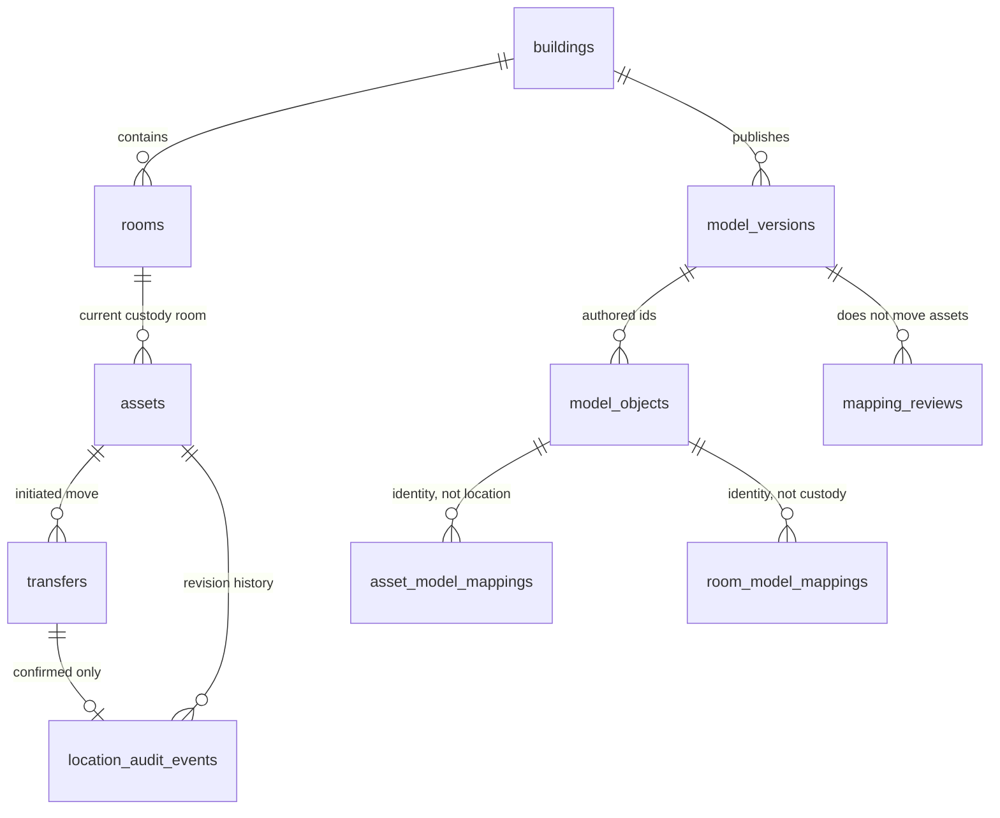

# Architecture

This document describes the database starter and the product boundary around it. It does not describe a running service. English in this file is the source of truth for behavior.

## Custody and rendering

An asset UUID answers "which custody record is this?" A glTF extras id or an IFC GlobalId answers "which authored object in which model version is this?" A Three.js runtime UUID answers neither. It changes when a scene is rebuilt, and this schema has no column for it.

Registration may set the first known room. That is data entry, not detection. After that, `assets.current_room_id` moves only inside `confirm_transfer`. Mapping tables are not a second location.

## Transfer protocol

`initiate_transfer(asset, to_room)` locks the asset, stores the current room and location revision, and inserts a row with status `initiated`. The room does not change.

`confirm_transfer(transfer)` locks the transfer, then the asset.

- `confirmed`: the asset is still at the recorded room and revision. In that same transaction the function marks the transfer confirmed, moves the room, increments the revision by 1, and inserts one `transfer_confirmed` audit row.
- `already_confirmed`: the transfer was already confirmed. No second audit row and no second move.
- `conflict`: the asset's room or revision changed after initiation. The transfer becomes `conflict`. The asset and the audit table stay as they were.
- `already_conflict` and `cancelled`: no write.
- `not_found`: no write.

`cancel_transfer` can cancel only an `initiated` row. `confirmed_irreversible` means the function refused to undo a completed move. Undoing custody is a new transfer, not a delete.

Two operators can both initiate from the same revision. The first confirmation to commit wins. The other confirmation becomes `conflict`. The SQL functions take row locks so those sessions serialize. The concurrent checks in `db/tests/run.sh` cover that with two sessions. A single-session check in `05_transfer_conflict.sql` covers the same final state without overlapping transactions.

If the audit insert fails, the room change and the status change roll back with it. `06_transfer_rollback.sql` forces that failure, and it also rolls back a successful confirmation.

At commit, a deferred constraint trigger calls `location_audit_is_consistent()`. A committed database cannot hold an asset whose revision, current room, and audit rows disagree, or a confirmed transfer without exactly one matching audit row. The trigger is starter-scale: it scans those tables once per changed row.

## Model identity

`model_versions` is an immutable label for one publication of one building. `source_kind` is `gltf` or `ifc`. Replacing a file is a new version. Mappings are not copied forward.

`model_objects.stable_id` is the authored id:

| `stable_id_kind` | Accepted stored form |
| --- | --- |
| `gltf_extras` | Trimmed text, 1–128 characters, not a bare integer |
| `ifc_global_id` | Exactly 22 characters from `0-9`, `A-Z`, `a-z`, `_`, `$` |

`register_model_object` turns a blank, untrimmed, over-long, bare-integer, or malformed IFC value into a `mapping_reviews` row and does not insert a model object. A duplicate id inserts a review that points at the existing object and does not change that object or its accepted mapping. The same authored string may be registered again on a different model version; that new object starts with no mapping.

A UUID-shaped extras string is stored if the caller submits it as `gltf_extras`. The schema does not know whether a person authored it or a viewer copied `Object3D.uuid`. Stopping that copy is parser work, and there is no parser here.

Room mappings must stay inside the model version's building. `propose_room_mapping` records `room_building_mismatch` and writes no mapping row when they differ. A direct insert of that pair fails.

Asset mappings do not have to match the asset's current building. The schema cannot see which mesh sits inside which room. Linking the cart's custody record to an object in the north model does not move the cart. If a person or a future importer already knows the observed room, they call `flag_custody_room_mismatch`. When the rooms differ, that function inserts `custody_room_mismatch` and does not change `current_room_id`. Resolving the review does not move the asset either.

Accepted mapping rows cannot change their asset, room, or model object. A correction is a new model version, or a still-`proposed` row that is rejected instead of accepted. There is no function that rewrites an accepted link.

## Reviews

`mapping_reviews` is append-only except for `open` → `resolved`. The subject columns stay as they were. Resolution has no trigger into `assets` or the mapping tables. That is deliberate: a review is not an instruction to reassign anything.

Review kinds used by the starter:

| Kind | Opened by | What it does not do |
| --- | --- | --- |
| `missing_stable_id` | `register_model_object` | Does not invent an id |
| `rejected_unstable_id` | `register_model_object` | Does not store a node index or a bad IFC id as identity |
| `duplicate_stable_id` | `register_model_object` | Does not retarget the first object |
| `room_building_mismatch` | `propose_room_mapping` | Does not insert a room mapping |
| `custody_room_mismatch` | `flag_custody_room_mismatch` | Does not confirm a transfer |
| `unmatched_model_object` | `open_unmatched_object_review` | Does not accept a mapping |

`open_unmatched_object_review` is explicit. Registering an object does not open that review by itself, so a later statement in the same import can still propose a mapping. A future batch command has to decide when the import is finished and call the review function. That command is not in this repository.

## Privilege gap

`app.write_path` is set with `set_config(..., true)` for the current transaction. Triggers allow location writes and audit inserts only for the expected value. This stops ordinary SQL. It does not stop the table owner. The owner can set the same value and write a transfer, a room change, and a matching audit row. Those rows would pass the commit check because they are internally consistent.

The append-only audit trigger does not look at `app.write_path`. Update and delete of audit rows fail even after the setting is turned on. Tests cover that.

A non-owner role with execute rights on the functions, and without update rights on the tables, is the intended fix. It is issue 005 and it is not implemented. No passwords or role definitions are included.

## Transaction rollback versus undoing a move

Rollback means the database transaction did not commit, so the room and the audit row return to the earlier state. It is not a business reversal. After `confirmed` is committed, history stays. `cancel_transfer` will not delete it.

## Synthetic fixture story

`db/fixtures/synthetic.sql` loads two invented buildings, three invented rooms, and two invented assets. `AST-SYN-001` (`Synthetic cabinet`) is registered in `RM-101` and then confirmed into `RM-102`. Its accepted glTF extras id remains `syn.asset.cabinet`. `syn.asset.unmatched` has no mapping. `AST-SYN-002` (`Synthetic cart`) stays in `RM-201`. One IFC room id, `SYN0000000000000000A01`, is mapped to `RM-101` on a separate model version.

Those names are not people, customers, organizations, or real facilities.

## Tests and what they cannot show

`db/tests/run.sh` is the check. SQL files cover fixtures, foreign keys, immutable identity, the write gate, idempotent confirmation, conflict, rollback, cancellation, authored ids, room mismatch, and custody reviews. Two extra cases use two database sessions.

They do not show:

- that a future parser ignores Three.js runtime UUIDs
- that a person can complete the flow in a browser
- that a least-privilege role is in place
- behavior under a production-sized audit table
- network failure, backups, or replication
